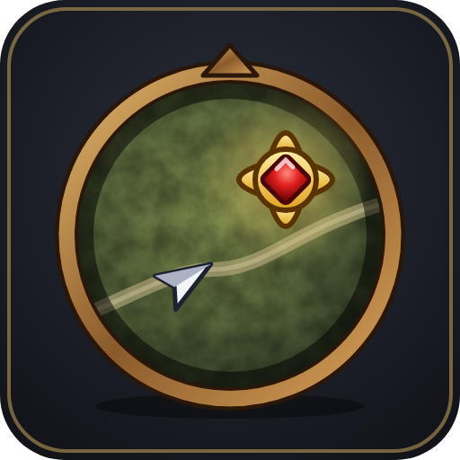
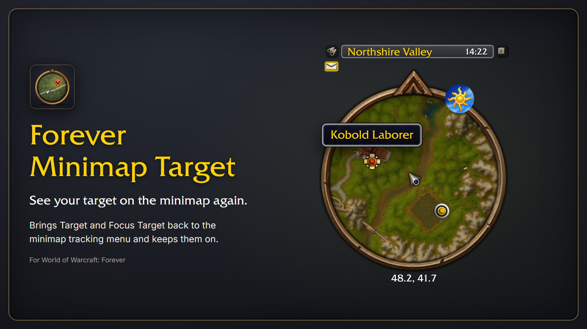
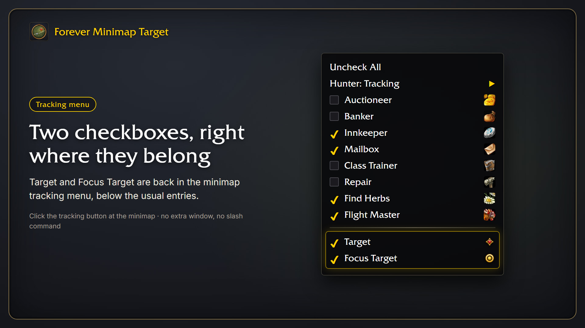
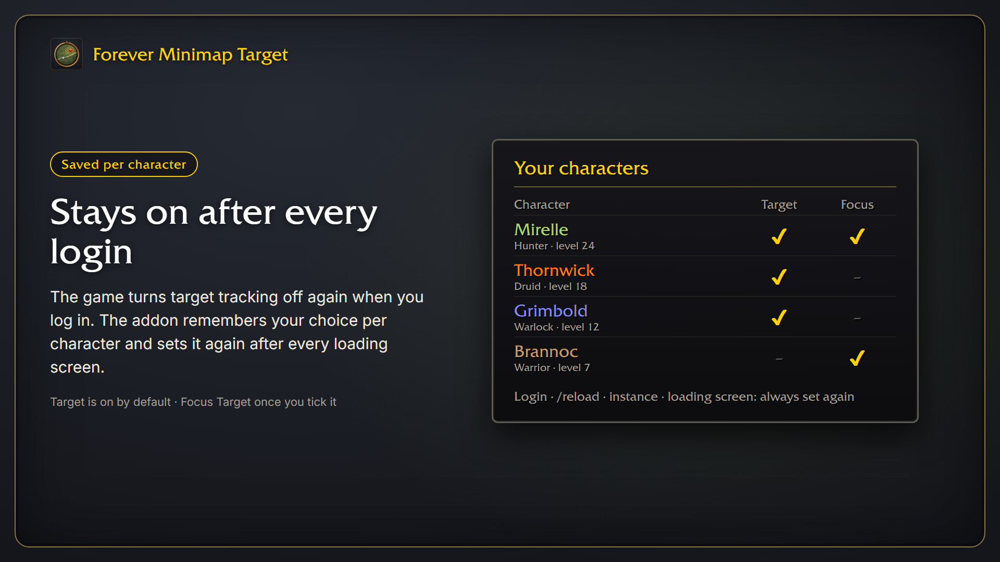

# Forever Minimap Target

Puts **Target** and **Focus** back into the minimap tracking menu in **World of Warcraft: Forever**, so your target and focus show up on the minimap again.

## Usage

Click the tracking button at the minimap and tick **Target**, **Focus** or both. Target is on by default.

The game forgets these at every login, so the addon saves your choice per character and sets it again after every loading screen.

If you have the full tracking list switched on (`/console minimapTrackingShowAll 1`), the game already lists both entries and the addon does nothing.

## About me

I'm Sven. I've been a software developer for over 20 years, and I write and maintain my World of Warcraft addons in my free time. They are free and open source, and they will stay that way.

Found a bug or have an idea? Open an [issue](https://github.com/svengabr/ForeverMinimapTarget/issues) or send me a DM on [CurseForge](https://www.curseforge.com/members/conoar).

## Support

The addon is free and always will be. If it made your game a bit nicer, you can [buy me a coffee](https://buymeacoffee.com/conoar) or send something via [PayPal](https://paypal.me/svengabr).
